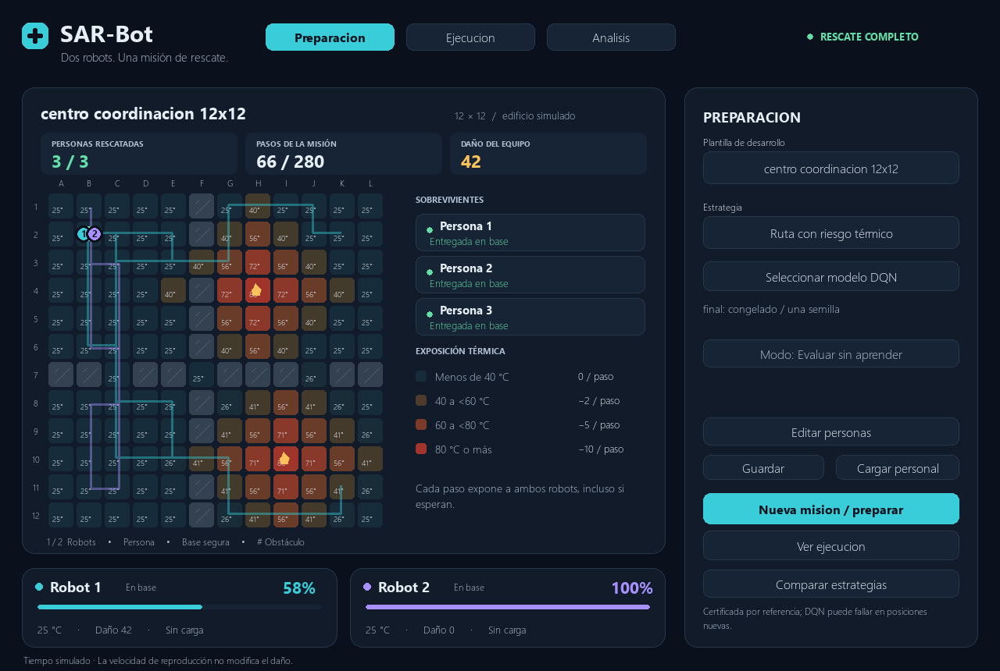

# SAR-Bot

Simulador académico de rescate con **dos robots, tres personas y edificios de 12 × 12**, editor visual, riesgo térmico y cuatro estrategias comparables. Versión final del alcance acordado el **26 de noviembre de 2026**.

## Abrir el proyecto

Requisitos: Windows, Python 3.12 y `uv`. Las versiones de dependencias están fijadas en `uv.lock`; PyTorch usa CPU.

```powershell
uv sync --locked --extra ui --extra rl --python 3.12
.\run.bat
```

Después de instalar, basta hacer doble clic en **run.bat**. Abre el edificio grande con la referencia térmica. La preparación comienza pausada: pulsa **Ver ejecución** y luego iniciar. Puede ejecutarse sin Internet una vez instaladas las dependencias.



## Qué incluye

- Motor de movimientos simultáneos, paredes, base compartida, recogida y entrega automática; un robot transporta una persona por viaje.
- Daño acumulado por temperatura **en cada paso**, incluso al esperar: menos de 40 °C → 0; 40–59 → 2; 60–79 → 5; desde 80 → 10. Integridad inicial 100.
- Editor para colocar tres personas en edificios preparados, validación y guardado de escenarios personalizados. La certificación por referencia no garantiza que DQN resuelva el caso.
- Pausa, avance por pasos, velocidad visual, trayectorias, integridad, historial, reproducción, exportación y comparación sobre el mismo escenario.
- Controlador DQN entrenado, rutas corta y térmica, y acciones aleatorias. Una política centralizada elige entre 25 movimientos conjuntos para los dos robots.
- Modo **Aprender y guardar**: al terminar una misión DQN nueva, actualiza la red y conserva modelo, optimizador, memoria y contadores entre ejecuciones. Evaluar, comparar y reproducir no actualizan pesos.

## Resultado real del aprendizaje

El modelo final está en `artifacts/final/model.zip`, congelado antes de abrir la partición de prueba. Se entrenó con **una semilla** y se seleccionó usando validación: **3/20 misiones completas**, 18/60 personas entregadas.

| Estrategia | Misiones completas en prueba | Personas entregadas |
|---|---:|---:|
| DQN final | 0/40 | 16/120 |
| Ruta corta | 33/40 | 112/120 |
| Ruta térmica | 40/40 | 120/120 |
| Aleatoria, cinco semillas | 2/200 | 133/600 |

**DQN no generalizó a las ubicaciones reservadas.** La aplicación y el aprendizaje persistente funcionan; eso no significa que el controlador aprendido sea un rescatista fiable. Los casos se certificaron con referencias, lo que favorece sus resultados. El [informe](docs/INFORME.md) explica estos límites y las comparaciones emparejadas.

## Demostrar DQN y la persistencia

Caso conocido de validación, usado durante la selección; entrega tres personas en 126 pasos, sin daño. No es evidencia de generalización:

```powershell
.\run.bat --scenario scenarios/demo_final.json --strategy dqn
```

Para aprender, selecciona DQN y cambia **Modo: Evaluar sin aprender** a **Modo: Aprender y guardar**. Finaliza una misión y espera el aviso de guardado antes de preparar otra. Al reiniciar el programa, activa de nuevo ese modo para recuperar la sesión. Se guarda en `outputs/learning_sessions/`, separada por perfil y hash del modelo base. El modelo final permanece intacto. La actualización puede mejorar o empeorar la política.

```powershell
.\run.bat --strategy dqn --learn --scenario scenarios/partitions/v2_12x12/training/hub_training_01_easy.json
```

Las posiciones reservadas de prueba se rechazan en modo aprendizaje. El paquete distribuido comienza con una sesión vacía; las sesiones personales no se versionan.

## Documentación y evidencia

- [Guion para presentar y comandos de respaldo](docs/DEMO.md).
- [Informe técnico final](docs/INFORME.md), [resultados y figuras](results/final/figures/tablas.md).
- [Estado de cierre y verificación](docs/VERSION_FINAL.md), [alcance acordado](docs/ALCANCE.md).
- [Interfaz](docs/INTERFAZ.md), [aprendizaje](docs/APRENDIZAJE.md), [contratos del motor](docs/CONTRATOS_V2.md).
- [Particiones congeladas](docs/PARTICIONES_V2.md), [métricas](docs/METRICAS.md).
- [Contexto para el equipo](README_EQUIPO.md) y [backlog histórico con cierre del alcance final](BACKLOG.md).

## Comprobar la entrega

```powershell
uv run --locked --extra ui --extra rl python -m unittest discover -s tests
uv run --locked --extra rl python scripts/evaluate_experiment.py --verify results/final/test.csv
uv run --locked python scripts/report_figures.py --check results/final/figures
```

La verificación reproduce trazas guardadas; no vuelve a entrenar ni abre una nueva prueba final. El protocolo y sus hashes están en `configs/final_protocol.json`; `configs/final_protocol.started.json` acredita que la ejecución final terminó. Los experimentos descartados se conservan en `results/sarb017/`. Los modelos pequeños V1 son antecedentes, no el modelo recomendado para 12 × 12.

Este proyecto es una simulación académica. DQN, la interfaz y el diseño de dos robots son decisiones del equipo; el repositorio no contiene una rúbrica confirmada del profesor.
