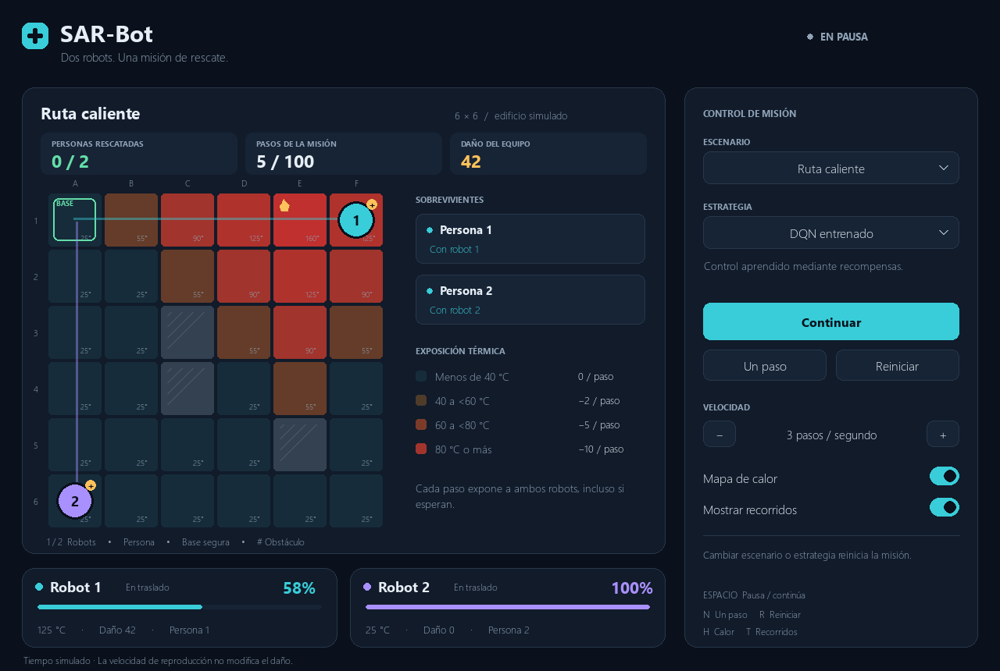

# SAR-Bot

**Para incorporarse al equipo:** empezar por [README_EQUIPO.md](README_EQUIPO.md) y continuar con el [backlog de entrega](BACKLOG.md). Esta página conserva la referencia técnica de la base implementada.

Simulación académica de rescate cooperativo: dos robots deben evacuar a dos sobrevivientes en un edificio 2D con riesgo térmico acumulativo.

**Asignatura:** Sistemas Inteligentes. **Equipo:** cuatro personas. **Plazo objetivo:** una semana.

## Estado del proyecto

Ya existe el motor, una interfaz Pygame, referencias geométrica y térmica, evaluación CSV y un entorno Gymnasium con entrenamiento DQN reproducible. El modelo recomendado usa sensores locales y completa los seis controles de entrenamiento, dos casos de validación y dos de prueba. Resuelve el pasillo compartido que fallaba antes; todavía no demuestra mejor gestión térmica ni generalización amplia.

- [Contexto, alcance y reglas acordadas](docs/CONTEXTO.md)
- [Plan de trabajo y base de la persona 1](docs/PLAN_DE_TRABAJO.md)
- [Referencias y primeros resultados de desarrollo](docs/EVALUACION.md)
- [Instalación, observaciones, recompensas y entrenamiento](docs/APRENDIZAJE.md)
- [Interfaz visual y controles](docs/INTERFAZ.md)
- [Guía para los cuatro integrantes](README_EQUIPO.md)
- [Backlog con responsables, dependencias y criterios de aceptación](BACKLOG.md)

Nosotros asumimos el rol de **persona 1**: construir la base integrada, implementar el aprendizaje y orientar la integración para que las otras tres personas continúen el entorno, la visualización y la evaluación.

## Objetivo

Investigar si un controlador aprendido puede coordinar dos robots para completar rescates, equilibrando duración de la misión y daño térmico. Se comparará con una estrategia programada bajo las mismas condiciones.

## Tecnología prevista

Python, NumPy, Gymnasium, Stable-Baselines3 con DQN y Pygame. Las versiones están fijadas en `uv.lock`, con PyTorch CPU.

## Principio térmico

El daño depende de la **temperatura y el tiempo de exposición**, incluso cuando el robot espera. Ambos robots acumulan exposición en cada paso global. La velocidad de reproducción de la interfaz no modifica el tiempo simulado.

## Desarrollo

El motor y las referencias usan únicamente la biblioteca estándar de Python 3.11 o superior. El aprendizaje requiere el extra `rl`. Los cambios se trabajan en ramas `feature/…`.

### Abrir la interfaz

```powershell
uv sync --extra ui --extra rl --python 3.12
uv run --extra ui --extra rl python scripts/ui.py
```

Abre el pasillo compartido con el modelo recomendado. Permite cambiar escenario y estrategia, iniciar, pausar, avanzar un paso, reiniciar y ajustar la velocidad. Muestra temperatura, recorridos, rescates e integridad de ambos robots.



El primer episodio se prepara en segundo plano y comienza pausado. La velocidad solo afecta la reproducción; no modifica el daño. Los controles y la arquitectura están en [INTERFAZ.md](docs/INTERFAZ.md).

### Ejecutar el agente ya entrenado

```powershell
uv sync --extra rl --python 3.12
uv run --extra rl python scripts/demo.py --strategy dqn --model artifacts/sensors_dqn/model.zip
```

Para comparar el modelo cargado con las referencias:

```powershell
uv run --extra rl python scripts/evaluate_dqn.py --model artifacts/sensors_dqn/model.zip --split training
```

El modelo recomendado es el checkpoint de 60000 pasos de un entrenamiento de 155000. El último checkpoint empeoró y no fue seleccionado. Sus metadatos y resultados están en `artifacts/sensors_dqn/`. Se conserva la evidencia de los experimentos anteriores en `artifacts/initial_dqn/` y `artifacts/cooperation_dqn/`. Cada configuración se probó con una sola semilla; no es una entrega final validada.

Para reproducir el pasillo compartido:

```powershell
uv run --extra rl python scripts/demo.py --strategy dqn --model artifacts/sensors_dqn/model.zip --scenario scenarios/pasillo_compartido.json
```

El modelo recomendado entrega ambas víctimas en 22 pasos, sin daño; la referencia geométrica necesita 20. En el escenario más caliente, DQN y la ruta corta reciben 74 puntos de daño; la referencia térmica recibe 34, pero tarda más. No se debe afirmar superioridad térmica de DQN.

### Entrenar y verificar

```powershell
uv run --extra rl python -m unittest discover -s tests -v
uv run --extra rl python scripts/train.py --config configs/dqn_sensors.json --run-dir outputs/nuevo-experimento
```

El directorio del experimento debe estar vacío. El entrenamiento registra episodios y evaluaciones, y guarda modelos por etapa, final y mejor. Sin `--config` conserva la configuración histórica inicial. No hace falta entrenar para ejecutar los checkpoints incluidos.

### Ejecutar solo el motor y las referencias

Con Python disponible:

```powershell
python scripts/demo.py
python scripts/demo.py --json
python -m unittest discover -s tests -v
```

Si Python está administrado por `uv`, ejecutar desde la raíz del repositorio:

```powershell
uv run --no-project --python 3.12 scripts/demo.py
uv run --no-project --python 3.12 -m unittest discover -s tests -v
```

La demostración usa una secuencia programada para `scenarios/demo.json`: rescata a las dos víctimas en diez pasos globales; los robots terminan con integridad 82 y 100. **No es una política aprendida ni una referencia general de navegación.**

Para usar navegación automática y calcular rutas a partir del mapa:

```powershell
uv run --no-project --python 3.12 scripts/demo.py --strategy shortest
uv run --no-project --python 3.12 scripts/demo.py --strategy shortest --scenario scenarios/pasillo_compartido.json
uv run --no-project --python 3.12 scripts/demo.py --strategy random --seed 0
```

`shortest` asigna víctimas distintas y busca movimientos conjuntos para llegar a los objetivos actuales en el menor número de pasos, sin considerar temperatura. Puede esperar o apartar un robot para evitar bloqueos; no garantiza completar cualquier misión. `random` selecciona entre las 25 acciones conjuntas usando una semilla reproducible. La demostración devuelve código de salida 1 si la misión fracasa o agota el tiempo.

`thermal` añade el daño previsto al costo de los movimientos para buscar rutas más seguras. Tampoco aprende. La comparación de referencias incluye las tres estrategias.

Para evaluar todas las referencias sobre los tres escenarios actuales:

```powershell
uv run --no-project --python 3.12 scripts/evaluate.py
```

El CSV se guarda en `outputs/reference_results.csv`, excluido de Git porque puede regenerarse. Se pueden indicar `--scenarios`, `--strategy`, `--seed` y `--output`. Esta ejecución produce un episodio por escenario y estrategia; no es una evaluación estadística ni un conjunto de prueba reservado.

Las particiones para el aprendizaje están en `configs/scenario_splits.json`. La comparación DQN admite `--split training`, `--split validation` o `--split test`, y genera metadatos con hashes. Los mapas nuevos se consultaron después de fijar el checkpoint; solo hay dos casos de prueba.

### Archivos para continuar

| Archivo | Función |
|---|---|
| `src/sar_bot/core/simulation.py` | Estado y reglas del entorno |
| `scenarios/demo.json` | Primer mapa y parámetros térmicos |
| `scripts/demo.py` | Reproducción por consola y salida JSON |
| `tests/test_simulation.py` | Verificación de reglas críticas |
| `src/sar_bot/agents/reference.py` | Asignación, navegación conjunta y política aleatoria |
| `scripts/evaluate.py` | Ejecución de referencias y exportación CSV |
| `tests/test_reference.py` | Verificación de navegación y evaluación |
| `src/sar_bot/env/rescue_env.py` | Observaciones y recompensa de Gymnasium |
| `scripts/train.py` | Entrenamiento por etapas y checkpoints |
| `scripts/evaluate_dqn.py` | Comparación de una política guardada con referencias |
| `configs/dqn_initial.json` | Configuración reproducible del primer experimento |
| `artifacts/initial_dqn/` | Modelo seleccionado, metadatos y resultados medidos |
| `configs/dqn_sensors.json` | Experimento recomendado, con exploración por etapa y sensores |
| `configs/scenario_splits.json` | Escenarios de entrenamiento, validación y prueba |
| `artifacts/sensors_dqn/` | Modelo recomendado y comprobaciones de las tres particiones |
| `scripts/ui.py` | Ventana interactiva y capturas sin ventana |
| `src/sar_bot/ui/app.py` | Presentación y controles Pygame |
| `src/sar_bot/ui/playback.py` | Episodios del motor y reloj de reproducción |

`RescueSimulation.step(acción_conjunta)` avanza una unidad de tiempo para ambos robots. `snapshot()` expone datos JSON, y `reset()` reinicia el escenario estático. La acción conjunta es `5 * acción_robot_1 + acción_robot_2`, con acciones `UP=0`, `DOWN=1`, `LEFT=2`, `RIGHT=3`, `WAIT=4`.

La validación actual comprueba estructura y conectividad del mapa. La misión del escenario de demostración se verifica con una trayectoria completa. Todavía no existe un validador general de viabilidad térmica y coordinación para escenarios arbitrarios.

### Próximo hito

Implementar el editor para que el profesor coloque dos personas antes de la misión, entrenar con posiciones variables y cerrar la evaluación y presentación. El editor todavía no está implementado. La fuente principal de tareas pendientes es [BACKLOG.md](BACKLOG.md); batería, urgencia y fuego dinámico quedan fuera de este alcance.

También falta mejorar la gestión térmica y repetir con varias semillas y más mapas reservados. Los resultados de prueba actuales ya se han consultado; para el nuevo desarrollo se conservarán como antecedentes y se reservarán nuevas configuraciones antes de la evaluación final.
