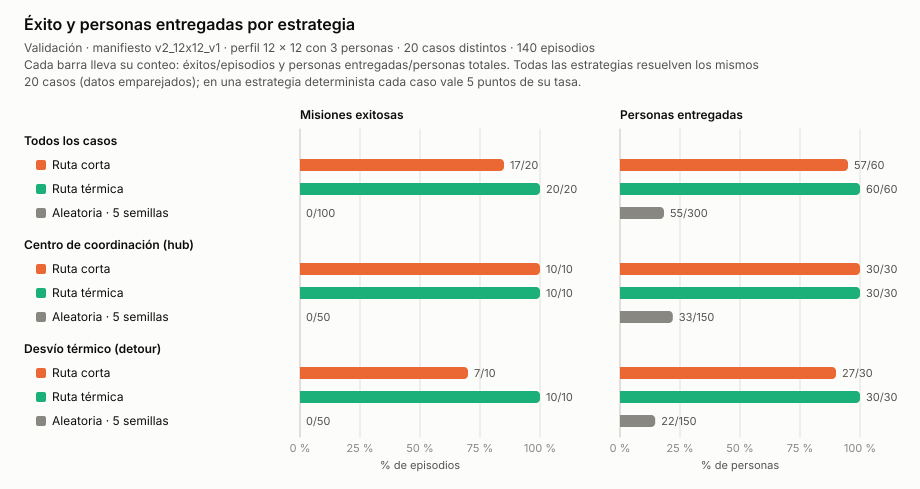
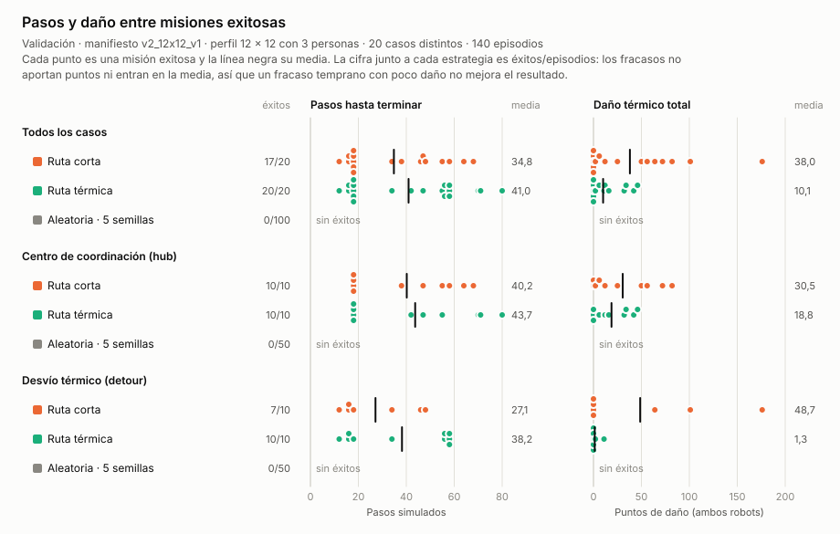
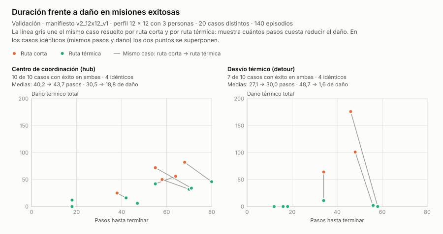
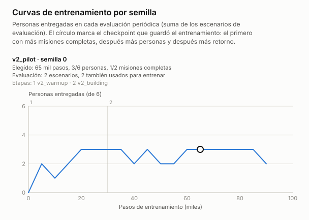

# Tablas y figuras del informe (SARB-022)

**Responsable:** persona 4. **Revisa:** persona 3. **Actualización:** 18 de noviembre de 2026.

Este documento explica cómo se producen las tablas y figuras del informe a partir de los resultados conservados. Ninguna cifra se copia a mano: todo sale de un CSV de `scripts/evaluate_experiment.py` (SARB-020) y de los registros de entrenamiento de cada modelo. La evaluación final (SARB-021) usará el mismo script sobre el CSV de prueba.

## 1. Qué se genera

`scripts/report_figures.py` escribe en un directorio de salida:

| Archivo | Contenido | Criterio de SARB-022 que cubre |
|---|---|---|
| `exito_y_rescates.svg` | Misiones exitosas y personas entregadas por estrategia, en total y por edificio | Éxito y personas entregadas por estrategia |
| `pasos_y_danio_exitos.svg` | Cada misión exitosa como un punto, con la media y el conteo éxitos/episodios | Daño y pasos entre éxitos con tamaño de muestra |
| `duracion_vs_danio.svg` | Pasos frente a daño de las misiones exitosas por edificio; una línea une el mismo caso resuelto por la ruta corta y por la térmica | Costo de elegir rutas seguras y casos emparejados |
| `curvas_entrenamiento.svg` | Personas entregadas en cada evaluación periódica, un panel por semilla, con el checkpoint elegido | Curvas de entrenamiento por semilla |
| `tablas.md` | Fuentes con hashes, resultado por estrategia, por edificio y por familia, comparaciones emparejadas, variación entre semillas y límites de lectura | Tablas generadas desde los CSV |
| `fuentes.json` | Rutas y SHA-256 de cada entrada, comando de regeneración y hash de cada salida | Instrucciones de regeneración |

Las curvas solo se generan si se pasan carpetas de entrenamiento con `--training`, y las tablas y las otras tres figuras solo si se pasa `--results`.

## 2. Cómo se generan

```powershell
# Evidencia de esta tarea: referencias sobre la validación 12 × 12.
uv run python scripts/report_figures.py --results results/sarb020/v2_12x12_validation_referencias.csv --output-dir results/sarb022/validacion_12x12

# Piloto 10 × 10 de desarrollo, con la curva del modelo evaluado.
uv run python scripts/report_figures.py --results results/sarb020/v2_10x10_piloto_desarrollo.csv --training artifacts/v2_pilot --output-dir results/sarb022/piloto_10x10

# Comprobar que un directorio coincide con sus fuentes.
uv run python scripts/report_figures.py --check results/sarb022/validacion_12x12
```

Antes de dibujar, el script reproduce cada traza del CSV en un motor nuevo y se detiene si alguna métrica no coincide, o si el CSV o sus trazas cambiaron después de escribirse. `--skip-replay` solo comprueba el hash del CSV y queda anotado en `tablas.md`.

El script no necesita Gymnasium, PyTorch ni matplotlib. Las figuras son SVG escritos directamente, y su contenido depende solo de las entradas. Por eso `--check` puede regenerarlas y compararlas byte a byte: detecta una tabla o una figura editada a mano, un archivo que falta o una fuente que cambió.

### Para la evaluación final (SARB-021)

```powershell
uv run python scripts/report_figures.py --results results/final/test.csv --training artifacts/<semilla0> --training artifacts/<semilla1> --training artifacts/<semilla2> --output-dir results/final/figuras
```

Si el CSV tiene filas DQN, cada carpeta de `--training` debe contener el mismo `model.zip` que se evaluó (se compara su SHA-256 con `model_sha256` del CSV). Así no se muestra la curva de un modelo distinto al de la tabla. Si el CSV solo tiene referencias, las curvas se generan en un directorio aparte.

## 3. Reglas que aplica el script

- **Siempre con denominador.** Cada barra lleva `éxitos/episodios` o `personas entregadas/personas totales`. El símbolo `%` solo aparece en el eje, y las tablas no usan porcentajes.
- **Primero el éxito.** Pasos y daño se dibujan y promedian solo con misiones exitosas, y el conteo `k/n` está junto a cada estrategia. Una estrategia sin éxitos aparece como «sin éxitos», no con un daño bajo.
- **Casos emparejados.** La tabla 4 compara cada par de series con un episodio por caso, solo sobre los casos que ambas resolvieron. Informa cuántos casos resolvió solo una, cuántos ninguna, y en cuántos B queda por debajo, igual o por encima de A.
- **Sin intervalos engañosos.** Todas las estrategias y semillas se evalúan sobre los mismos casos, así que los episodios no son independientes. No se dibujan intervalos de confianza. Se muestra cada semilla DQN por separado, su rango y cuántos casos resuelve cada número de semillas.
- **Tamaño de muestra visible.** El subtítulo de cada figura indica los casos distintos y cuánto vale un caso en la tasa de una estrategia determinista; con 20 casos, cada uno vale 5 puntos.
- **El color sigue a la estrategia.** DQN es azul, la ruta corta naranja y la térmica verde azulado; la aleatoria va en gris como referencia sin información. Los tres colores se validaron para daltonismo en todos los pares. Cada fila lleva además su nombre, así que el color nunca es la única forma de identificarla.
- **Curvas honestas.** El panel de cada semilla indica cuántos escenarios de evaluación también se usaron para entrenar. El checkpoint marcado es el que guardó el entrenamiento, con el mismo criterio que `scripts/train.py`: más misiones completas, después más personas y después más retorno.

Las figuras tienen título y descripción accesibles, y cada marca lleva un texto emergente con el caso y su valor al abrirlas en un navegador. Cada figura tiene su tabla equivalente en `tablas.md`.

## 4. Evidencia de esta tarea

Ninguna de las dos usa la partición de prueba.

- `results/sarb022/validacion_12x12/`: referencias sobre la validación `v2_12x12_v1`.
- `results/sarb022/piloto_10x10/`: piloto DQN `v2_pilot` y referencias en `warmup_10x10` y `building_10x10`, con su curva de entrenamiento. Es un resultado de desarrollo y no del perfil final.









Las cifras correspondientes están en `tablas.md` de cada directorio.

## 5. Uso en el informe

Word 2019, Microsoft 365 y LibreOffice insertan SVG directamente (Insertar → Imágenes), y se mantienen nítidos al imprimir. Si alguna herramienta exige PNG, se abre el SVG en un navegador y se exporta la imagen. El SVG conservado sigue siendo la fuente. Las tablas de `tablas.md` se copian al informe; el pie de cada una debe citar el directorio y el hash de `fuentes.json`.

## 6. Límites de lectura

- **Sesgo de certificación.** Los casos de las particiones entraron porque una referencia los resolvió. La tasa de éxito de las referencias está favorecida por construcción (ver `docs/PARTICIONES_V2.md`). `tablas.md` lo recuerda cuando el CSV viene de un manifiesto.
- **La aleatoria repite secuencia por semilla.** `RandomPolicy` elige acciones sin mirar el estado, así que con una misma semilla aplica la misma secuencia de acciones en todos los casos. En la validación, cada semilla produce el mismo desenlace en los 20 casos (las semillas 0, 1 y 3 destruyen un robot y las 2 y 4 agotan el límite). Sus 100 episodios son cinco secuencias aplicadas a 20 mapas, no 100 intentos independientes.
- **Familias heurísticas.** «Fácil», «intermedio» y «exigente» describen distancia y exposición inicial al generar los casos. No predicen el desempeño de DQN.
- **Curvas de desarrollo.** Los modelos históricos y el piloto evalúan durante el entrenamiento sobre escenarios que también entrenan; la figura lo indica. Las curvas de los modelos finales deben usar la validación (SARB-017/019).
