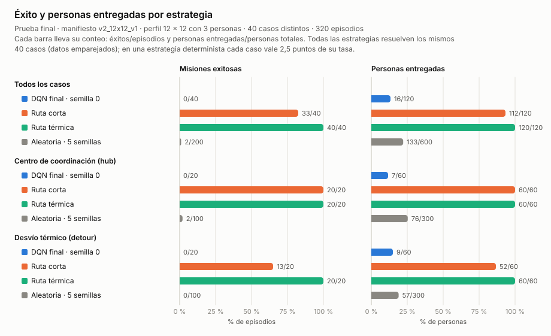
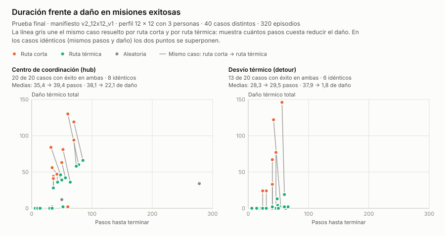

# SAR-Bot: rescate cooperativo con exposición térmica

Informe técnico final del alcance acordado el **26 de noviembre de 2026**. Asignatura: Sistemas Inteligentes. Equipo: cuatro integrantes. Código, configuraciones, modelos, trazas y resultados acompañan este documento en el repositorio.

## 1. Objetivo y resultado principal

SAR-Bot representa un edificio como una cuadrícula con paredes, una base segura, focos de calor y tres personas inmóviles. Dos robots deben recogerlas y llevarlas a la base; cada robot transporta una persona por viaje. Se estudia si una política aprendida puede coordinar la evacuación y responder a distintas posiciones, frente a estrategias programadas que priorizan distancia o exposición térmica.

Se entregan un motor reproducible, un editor visual, cuatro estrategias, entrenamiento DQN, aprendizaje persistente entre misiones y un evaluador con trazas verificables. El controlador DQN final obtuvo **3/20 misiones completas en validación y 0/40 en prueba**, aunque entregó parcialmente 16 de 120 personas de prueba. La referencia térmica completó 40/40 y la ruta corta 33/40. La implementación del aprendizaje funciona, pero los resultados no demuestran generalización satisfactoria del controlador aprendido.

## 2. Alcance y procedencia de los requisitos

El alcance de cierre, acordado antes de la evaluación final, conserva edificios de 12 × 12, dos robots, tres personas, editor y cuatro estrategias. Permite una semilla de entrenamiento y aprendizaje al finalizar cada misión nueva, en lugar de tres semillas y actualización en cada movimiento. La verificación de instalación se realiza en el computador disponible. Este acuerdo sustituye esos criterios del backlog original para esta versión; está documentado en [ALCANCE.md](ALCANCE.md).

La propuesta original no es una rúbrica confirmada. DQN, Pygame, control centralizado y riesgo térmico son decisiones del equipo. No se atribuyen al profesor requisitos que no estén registrados. No se incluyen batería, propagación de fuego, exploración sin mapa, visión artificial, varios pisos ni dinámica física tridimensional. Las temperaturas y daños son reglas de una simulación académica, sin pretensión de modelar un incendio real.

## 3. Entorno y reglas

El estado contiene posiciones, integridad y carga de los robots, estado de cada persona y pasos transcurridos. El escenario fija geometría, base, focos estáticos y límite de pasos. La temperatura de una celda es el máximo de las contribuciones de sus focos, calculadas con distancia Manhattan; las paredes no atenúan ese calor.

Cada turno aplica simultáneamente una acción individual por robot: arriba, abajo, izquierda, derecha o esperar. La acción conjunta se codifica como `5 × a1 + a2`, con 25 posibilidades. El motor impide atravesar paredes, coincidir fuera de la base e intercambiar posiciones de frente; permite avanzar a una celda que el otro robot está desalojando. La base admite ambos robots. Recogida y entrega ocurren automáticamente al ocupar la celda correspondiente.

**Tabla 1. Daño por robot y paso global.**

| Temperatura | Daño |
|---|---:|
| Menos de 40 °C | 0 |
| Desde 40 y menos de 60 °C | 2 |
| Desde 60 y menos de 80 °C | 5 |
| Desde 80 °C | 10 |

Cada robot empieza con integridad 100 y no se repara. Ambos reciben daño en su posición final en **todos** los pasos, incluso al esperar o intentar un movimiento bloqueado. Permanecer tres turnos a 70 °C produce 15 puntos de daño. La velocidad de la interfaz solo cambia la reproducción, no la exposición simulada. La destrucción se resuelve antes de recoger o entregar.

La misión tiene éxito al entregar las tres personas con ambos robots operativos; no es obligatorio que el robot sin carga termine en la base. Si un robot pierde toda su integridad, la misión falla. Alcanzar el máximo de pasos produce truncamiento. Se informa primero el éxito, después las entregas parciales y, entre éxitos, pasos y daño.

## 4. Agente aprendido

### Observación, política y restricciones

Se usa una **política centralizada** que controla dos agentes físicos. No son dos redes independientes. El perfil final tiene 390 entradas: `2WH + 11 + 7N = 320` valores del mapa y estado, más 70 sensores de vecindad y distancias. Para W=H=12 y N=3, incluye paredes, temperaturas normalizadas, posiciones, integridad, carga, personas entregadas y tiempo usado. El controlador conoce todo el mapa; las distancias de camino se calculan con esa información. La tarea es navegación y reparto, no búsqueda a ciegas.

La red Q tiene dos capas ocultas de 128 unidades y produce 25 valores. La máscara programada excluye movimientos contra paredes y ciertos conflictos entre robots, tanto en selección de acciones como en el máximo de la red objetivo. No decide qué persona rescatar ni qué ruta térmica tomar. Por tanto, evitar esas acciones inválidas no constituye un comportamiento descubierto íntegramente por la red. Las referencias usan planificación sobre el mismo motor; la aleatoria selecciona acciones conjuntas como control básico.

DQN actualiza los parámetros con transiciones `(observación, acción, recompensa, siguiente observación, fin)` de una memoria de repetición y una red objetivo. Durante entrenamiento combina exploración aleatoria y selección por valor Q; en evaluación elige de forma determinista. Los límites de tiempo se distinguen de terminaciones reales.

### Recompensa y configuración final

**Tabla 2. Componentes de recompensa.**

| Evento | Valor |
|---|---:|
| Paso | −1 |
| Persona recogida | +5 |
| Persona entregada | +50 |
| Misión exitosa | +100 |
| Destrucción | −100 |
| Límite de pasos | −20 |
| Cada punto de daño | −2 |
| Cambio de potencial de progreso | `2 × (Φ(siguiente) − Φ(actual))` |

El potencial negativo representa distancias restantes de evacuación, considerando personas transportadas y viajes adicionales. El descuento final es 1 y no se aplica el límite de potencial usado en otras configuraciones históricas. La recompensa es una elección de diseño, no una medida objetiva de calidad; comparar retornos de experimentos con recompensas diferentes sería incorrecto.

Configuración final: tasa de aprendizaje 0,0001, replay de 50000 transiciones, lote 64, inicio de actualización a 500 pasos, una actualización cada cuatro pasos y red objetivo actualizada cada 500. Los parámetros exactos y versiones están en `artifacts/final/metadata.json`.

### Entrenamiento y selección

Las particiones contienen 60 casos de entrenamiento, 20 de validación y 40 de prueba, en dos edificios conocidos, con distintas posiciones de personas y tres familias de dificultad. Los manifiestos registran identidades físicas y hashes; sus controles detectan solapamientos. Los casos fueron admitidos mediante certificación positiva por referencias, lo que condiciona sus resultados.

**Tabla 3. Experimentos de desarrollo, todos con semilla 0.** Los éxitos son sobre los mismos 20 casos de validación; las entregas tienen denominador 60.

| Configuración | Pasos RL nuevos | Paso elegido | Éxitos | Entregas |
|---|---:|---:|---:|---:|
| Control inicial | 120000 | 120000 | 0/20 | 1/60 |
| Recompensa densa | 120000 | 120000 | 0/20 | 5/60 |
| Acciones restringidas | 120000 | 40000 | 2/20 | 10/60 |
| Representación compacta | 120000 | 110000 | 1/20 | 6/60 |
| Currículo, seleccionado | 160000 | 100000 nuevos | 3/20 | 18/60 |
| Imitación y refinamiento RL, descartado | 20000 | 20000 | 1/20 | 14/60 |

Fuente: `results/sarb017/experiments.json` y registros de cada corrida. Son seis configuraciones relacionadas, **no seis semillas independientes**. Se realizaron 660000 pasos RL nuevos en estas corridas, además de un piloto previo de 6000. El experimento guiado también utilizó 2311 transiciones de demostraciones de la referencia térmica sobre entrenamiento y 200 épocas supervisadas; no fue seleccionado.

El currículo final parte del checkpoint de 40000 pasos de la corrida con máscara. Entrena 30000 pasos con una persona pendiente, 50000 con dos y 80000 con tres. Las personas restantes se consideran ya entregadas al inicio de los ejercicios parciales; no se recompensa esa inicialización. La evaluación siempre exige las tres personas pendientes. La corrida completa dura 160000 pasos nuevos y el checkpoint elegido corresponde a 100000 nuevos: su linaje contiene 140000 pasos contando el punto de partida. El modelo conserva el contador local de 100000 de la corrida reanudada. No recibió las demostraciones del experimento guiado.

La selección priorizó misiones completas y después personas entregadas en validación. Se consultó validación repetidamente para elegir configuración y checkpoint, por lo que su resultado es de desarrollo. La investigación se cerró antes de las 13:10 del día de entrega, conforme al presupuesto acordado.

## 5. Congelación y evaluación final

Se congelaron checkpoint, metadatos y protocolo **antes** de abrir los casos de prueba, en el commit `3f5eed5`. El modelo publicado tiene SHA-256 `0c68363d8471d52bba84ce4e1235fee70aaf4fcd592e3c254c43b365318d1bc5`. El protocolo exige una semilla, las cuatro estrategias y cinco semillas de acciones aleatorias; esta reducción de alcance estaba registrada previamente.

La ejecución reservada se abrió una vez y terminó el 26 de noviembre de 2026 a las 12:44 de Bogotá. `configs/final_protocol.started.json` registra apertura, terminación y hash del CSV. Se ejecutaron 320 episodios: 40 DQN, 40 ruta corta, 40 térmica y 200 aleatorios. Cada traza se reprodujo en un motor nuevo para comprobar las métricas. No se entrenó ni cambió el modelo final después de conocer prueba.

**Tabla 4. Prueba final.** Pasos y daño se promedian exclusivamente entre éxitos; el guion indica que no hay éxitos, por lo que el promedio no existe.

| Estrategia | Éxitos | Entregas | Destrucción | Tiempo agotado | Pasos medios en éxitos | Daño medio en éxitos |
|---|---:|---:|---:|---:|---:|---:|
| DQN final | 0/40 | 16/120 | 1 | 39 | — | — |
| Ruta corta | 33/40 | 112/120 | 7 | 0 | 32,6 | 38,1 |
| Ruta térmica | 40/40 | 120/120 | 0 | 0 | 39,1 | 12,2 |
| Aleatoria, cinco semillas | 2/200 | 133/600 | 119 | 79 | 164,0 | 23,0 |

Fuente: [tablas generadas](../results/final/figures/tablas.md), CSV y trazas en `results/final/`.



DQN no completa ninguna misión reservada, incluso en la familia fácil: entrega 12/36 personas fáciles, 4/42 intermedias y 0/42 exigentes. En 39 casos termina por tiempo y en uno por destrucción. Esto describe el modo de fallo medido; no permite atribuirlo a una única causa interna de la red. La diferencia con validación indica una capacidad de respuesta insuficiente a posiciones no usadas para selección.

Las medias de todas las misiones exitosas de corta y térmica corresponden a conjuntos diferentes. La comparación adecuada de pasos y daño usa los **33 éxitos comunes**: la corta tarda 32,6 pasos y recibe 38,1 de daño, frente a 35,5 y 14,1 de la térmica. En esos pares, la térmica añade 2,9 pasos y reduce 24 puntos de daño en promedio; causa menos daño en 18 y el mismo en 15. No se afirma optimalidad de ninguna referencia.



## 6. Aprendizaje persistente entre ejecuciones

El modo «Aprender y guardar» usa una copia de sesión del modelo. Cada misión nueva genera experiencia real con exploración del 10 %. Al finalizar su reproducción, se verifican todas sus transiciones en el motor, se incorporan al replay y se realizan hasta 64 actualizaciones. La tasa local es 0,00005, la memoria admite 4096 transiciones y los lotes tienen como máximo 64. No se modifica la red en cada fotograma.

Se conservan pesos, red objetivo, optimizador, replay, estados aleatorios y contadores. La sesión se identifica por dimensiones, cantidad de personas y hash del modelo base. Se publica una generación únicamente después de escribir y verificar sus archivos; el puntero anterior permite recuperación. Un bloqueo del sistema evita dos escritores simultáneos. Las pruebas cubren reinicio, deduplicación, memoria, publicación interrumpida y recuperación.

Pausar, reiniciar la reproducción, importar historial o comparar no genera actualizaciones. Una misión nueva tiene identidad propia para impedir que reproducirla entrene dos veces. Al cambiar a evaluación se usa el modelo base congelado. Las identidades reservadas de prueba se rechazan para aprendizaje. Las sesiones locales no forman parte del paquete de distribución.

### Comprobación real y efecto observado

Se lanzaron dos procesos independientes de la interfaz en modo sin ventana sobre `hub_training_01_easy` y `detour_training_01_easy`. La primera misión agotó 280 pasos y entregó una persona; la segunda recuperó el checkpoint y agotó 300 sin entregas. Se acumularon **2 misiones, 580 transiciones y 128 actualizaciones**, con replay de 580 elementos. Se verificó el cambio del hash de los parámetros de la red Q y la conservación del hash del artefacto base.

Sobre los 20 casos de validación, el modelo base obtuvo 3/20 éxitos y 18/60 entregas; tras esas dos misiones, la sesión obtuvo **0/20 y 3/60**. El aprendizaje local **empeoró** esta medición. Dos misiones no permiten estimar una tendencia: se demuestra persistencia y actualización, no mejora monotónica ni adaptación robusta. La comparación es descriptiva y no se utilizó para sustituir el checkpoint final. No volvió a evaluarse prueba con la sesión adaptada.

Fuentes: `results/online/persistence.json`, `comparison.csv`, sus trazas y el checkpoint de sesión archivado. El script `record_online_evidence.py` archiva y compara parámetros sin entrenar.

## 7. Interfaz y demostración

Pygame organiza preparación, ejecución y análisis. El editor conserva las paredes y focos del edificio y permite colocar tres personas, validar, guardar y cargar configuraciones. La misión muestra trayectorias, temperatura, estado de las personas e integridad por robot. El análisis compara estrategias sobre el mismo caso y permite conservar y reproducir el historial.

El inicio predeterminado utiliza la referencia térmica para mostrar rescates funcionales con ubicaciones certificadas. El ejemplo DQN `scenarios/demo_final.json` corresponde a `hub_validation_03_easy`: rescata tres personas en 126 pasos sin daño. Se declara su procedencia de validación porque fue usado al seleccionar el checkpoint. La plantilla inicial con referencia térmica completa tres entregas en 66 pasos y recibe 42 de daño.

La preparación y el aprendizaje ocurren fuera del hilo de dibujo; las operaciones incompatibles se bloquean mientras se guarda. Se incluyeron lanzador `run.bat`, guion de 5–10 minutos y capturas de respaldo. [DEMO.md](DEMO.md) explica qué mostrar y cómo presentar los fallos sin sustituirlos por comportamiento programado atribuido a la red.

## 8. Validez, límites y trabajo futuro

- **Una semilla:** no se estima variabilidad del entrenamiento. Las configuraciones comparten datos y linajes; no son réplicas independientes.
- **Selección repetida:** validación orientó varias decisiones. Prueba se abrió después de congelar, sin ajustes posteriores.
- **Certificación favorable a referencias:** los escenarios entraron porque algún planificador los resolvió. No permiten afirmar que la térmica resolvería cualquier disposición.
- **Dependencia entre casos:** dos geometrías conocidas y posiciones variantes. Las mismas cinco semillas aleatorias se reutilizan entre casos; 200 episodios no equivalen a 200 escenarios independientes. Se presentan conteos y pares, sin intervalos que supongan independencia.
- **Simplificación:** mapa completo, personas inmóviles, calor estático, sin batería ni incertidumbre perceptiva. La máscara añade conocimiento programado.
- **Aprendizaje local:** las actualizaciones pueden causar regresiones; el mecanismo de guardado no garantiza calidad. El checkpoint base y la separación de modos permiten volver al comportamiento reproducible.
- **Reproducibilidad:** las trazas permiten verificar reglas y métricas. Hardware y versiones pueden afectar tiempos de cómputo y trayectoria de un entrenamiento nuevo.

Una siguiente versión debería dedicar un nuevo presupuesto a varias semillas, una validación menos reutilizada, tareas más graduales, mejores representaciones y control de regresiones antes de promover una sesión aprendida. Esa investigación requeriría una nueva prueba reservada. No se agrega funcionalidad a esta entrega tras observar los resultados finales.

## 9. Entrega y reproducción

El alcance técnico final está cerrado con código integrado en `main`, modelo congelado, protocolo, datos de prueba, resultados del aprendizaje persistente, figuras, informe, guion y pruebas. [VERSION_FINAL.md](VERSION_FINAL.md) registra las verificaciones y la distribución. El backlog original conserva las aspiraciones previas como historial; no se marcan como realizadas tareas humanas ni tres semillas que no se ejecutaron.

```powershell
uv sync --locked --extra ui --extra rl --python 3.12
.\run.bat
uv run --locked --extra ui --extra rl python -m unittest discover -s tests
uv run --locked --extra rl python scripts/evaluate_experiment.py --verify results/final/test.csv
uv run --locked python scripts/report_figures.py --check results/final/figures
```

Las comprobaciones reproducen trazas y regeneran figuras desde fuentes conservadas; no entrenan ni repiten la apertura de prueba. Las referencias bibliográficas siguientes describen el marco conceptual; las cifras y configuraciones de este informe proceden de los archivos del proyecto.

## Referencias

Hart, P. E., Nilsson, N. J. y Raphael, B. (1968). A formal basis for the heuristic determination of minimum cost paths. IEEE Transactions on Systems Science and Cybernetics, 4(2), 100-107.

Mnih, V., Kavukcuoglu, K., Silver, D., Rusu, A. A., Veness, J., Bellemare, M. G., et al. (2015). Human-level control through deep reinforcement learning. Nature, 518(7540), 529-533.

Ng, A. Y., Harada, D. y Russell, S. (1999). Policy invariance under reward transformations: Theory and application to reward shaping. En Proceedings of the Sixteenth International Conference on Machine Learning (pp. 278-287).

Raffin, A., Hill, A., Gleave, A., Kanervisto, A., Ernestus, M. y Dormann, N. (2021). Stable-Baselines3: Reliable reinforcement learning implementations. Journal of Machine Learning Research, 22(268), 1-8.

Sutton, R. S. y Barto, A. G. (2018). Reinforcement learning: An introduction (2.ª ed.). MIT Press.

Towers, M., Kwiatkowski, A., Terry, J., Balis, J. U., De Cola, G., Deleu, T., et al. (2024). Gymnasium: A standard interface for reinforcement learning environments. arXiv:2407.17032.
