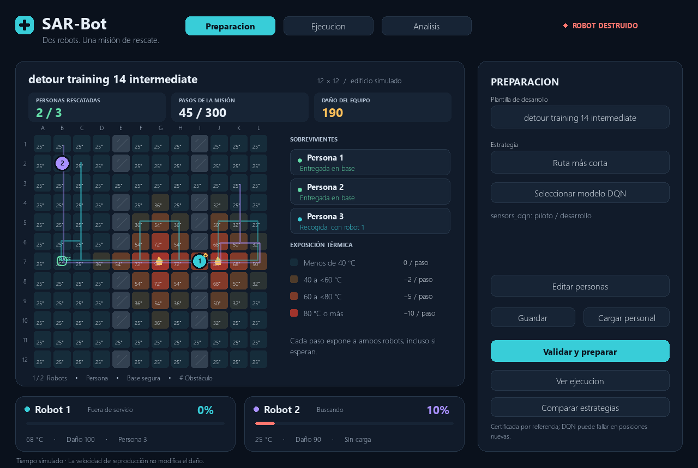
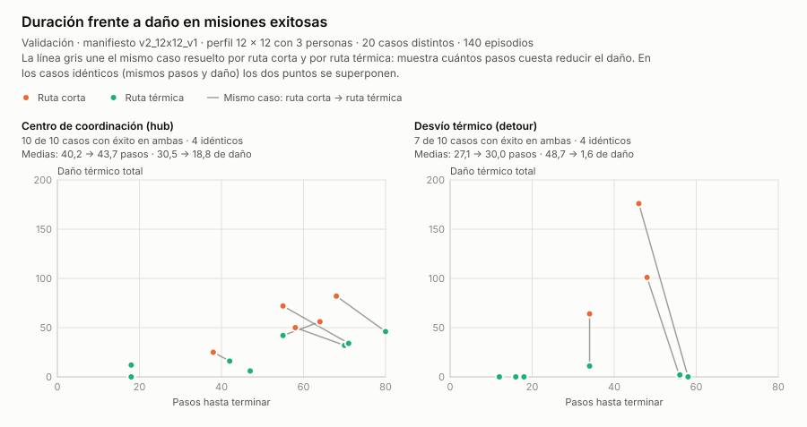

# Informe técnico de SAR-Bot (borrador)

**Coordina:** persona 4; aportan todos. **Revisa:** persona 1. **Versión:** borrador del 18 de noviembre de 2026.

## Estado del borrador

Este archivo es la fuente del informe final (SARB-025). Las secciones con evidencia ya están redactadas. Las marcas `[PENDIENTE]` señalan lo que depende de otras tareas y no deben quedar en la versión entregada.

- Formato y extensión: se definen con el profesor (SARB-002, `docs/ALCANCE.md`). Mientras tanto, el texto está escrito para pegarse en Word: tablas con «Tabla N.» encima y figuras con «Figura N.» debajo.
- Resultados de DQN en 12 × 12, curvas de entrenamiento y selección de modelos: SARB-017, SARB-019 y SARB-021.
- Análisis de fallos con trazas: SARB-023. Aprendizaje continuo: SARB-033 a SARB-035.
- Contribución de cada integrante con nombres: la completa cada persona.
- Si el curso lo exige, declarar el uso de herramientas de inteligencia artificial en la preparación del código y del texto.

Cada cifra de este borrador remite a un archivo versionado. Al actualizar resultados se regeneran las tablas con los scripts, en lugar de corregirlas a mano.

## 1. Introducción

SAR-Bot es un simulador académico de rescate en el que dos robots deben llevar a tres personas inmóviles hasta una base, dentro de un edificio bidimensional con paredes y focos de calor. Cada robot transporta a una persona por viaje, de modo que completar la misión exige repartir el trabajo y hacer al menos un segundo recorrido. El calor no impide el paso; desgasta a los robots según la temperatura y el tiempo de exposición, y un robot sin integridad queda fuera de servicio. La tarea combina, por tanto, navegación, coordinación entre dos agentes físicos y una decisión explícita entre llegar antes o exponerse menos.

La pregunta del trabajo es qué tan bien responde un controlador aprendido a distintas ubicaciones de las personas y cómo equilibra rescates, pasos y daño frente a estrategias clásicas de planificación. El objetivo general es formular el problema como un proceso de decisión secuencial (Sutton y Barto, 2018), entrenar una política con aprendizaje por refuerzo profundo mediante DQN (Mnih et al., 2015), mostrarla funcionando en una interfaz y evaluarla con datos reproducibles. No se parte del supuesto de que la red supere a un planificador; un resultado negativo, bien medido y explicado, también responde la pregunta.

## 2. Alcance

El equipo adoptó un edificio preparado de antemano, en el que el usuario coloca a las tres personas con un editor visual antes de iniciar la misión. Los focos de calor son estáticos y el control es centralizado: una sola política decide a la vez el movimiento de ambos robots. El objetivo de escala es un edificio de 12 × 12 celdas, construido sobre un hito integrado de 10 × 10. Quedaron fuera la batería, los plazos de supervivencia, el fuego dinámico, la visión artificial, los varios pisos y la física tridimensional.

Estas decisiones son del equipo. La Tabla 1 separa lo que el profesor confirmó de lo que decidió el grupo y de lo que queda como trabajo futuro; la versión completa, con fuentes y preguntas abiertas, está en la nota de alcance del proyecto.

Tabla 1. Origen de los requisitos del proyecto.

| Tipo | Contenido |
|---|---|
| Confirmado por el profesor | [PENDIENTE SARB-002: completar con las respuestas registradas en `docs/ALCANCE.md`, sección 1] |
| Decisión del equipo | Dos robots, tres personas, control centralizado, edificios preparados, focos estáticos, objetivo 12 × 12, DQN, interfaz Pygame, aprendizaje continuo |
| Trabajo futuro | Batería, fuego dinámico, exploración sin mapa, varios pisos, más robots, aplicación web |

Fuente: `docs/ALCANCE.md`.

## 3. Formulación del problema

El estado de una misión contiene la posición, la integridad y la carga de cada robot, el estado de cada persona (pendiente, transportada o entregada) y el número de pasos transcurridos. El escenario fija el tamaño del edificio, las paredes, la base, la temperatura de cada celda y un límite de pasos; la temperatura se obtiene de varios focos y se combina con un máximo. Todo el mapa es conocido por el controlador. El problema estudiado es de navegación, reparto y evacuación, no de búsqueda a ciegas.

En cada paso el controlador elige una acción conjunta entre 25, que codifica la acción de cada robot como `5 × acción_robot_1 + acción_robot_2`; las acciones individuales son arriba, abajo, izquierda, derecha y esperar. El motor resuelve ambos movimientos en simultáneo, impide atravesar paredes, ocupar la misma celda o intercambiar posiciones de frente, y aplica la recogida y la entrega de forma automática. Después cada robot recibe daño según la temperatura de su celda final, aunque haya esperado o chocado: 0 puntos por debajo de 40 °C, 2 entre 40 y 60, 5 entre 60 y 80 y 10 desde 80. La integridad parte de 100 y no se recupera.

La misión termina con éxito cuando las tres personas están en la base y ambos robots siguen operativos. Fracasa si un robot llega a integridad cero, y se trunca al alcanzar el límite de pasos. Para el aprendizaje, el entorno Gymnasium entrega una observación con paredes, temperaturas normalizadas, coordenadas, integridad, carga, estado de las personas y fracción del tiempo usado; son `2WH + 11 + 7N` valores, 320 en el perfil de 12 × 12. El modo con sensores añade 70 valores de vecindad y distancias de camino calculadas con el mapa completo.

La recompensa del piloto de 10 × 10 se resume en la Tabla 2. Incluye una guía de distancia con la forma basada en potencial que describen Ng, Harada y Russell (1999), pensada para no alterar la política óptima; usa el mismo descuento que DQN y se anula en los estados terminales reales. Mejorar el retorno no se toma como prueba de una mejor política: la métrica principal sigue siendo el rescate completo.

Tabla 2. Recompensa del piloto V2.

| Componente | Valor |
|---|---:|
| Paso global | −1 |
| Recogida | +5 |
| Entrega | +50 |
| Misión completa | +100 |
| Robot destruido | −100 |
| Límite de pasos | −20 |
| Punto de integridad perdido | −2 |
| Factor de la guía de potencial | 2 |
| Cota del potencial | 40 |
| Descuento | 0,99 |

Fuente: `artifacts/v2_pilot/metadata.json`. [PENDIENTE SARB-017: reemplazar por la configuración de los modelos finales si cambia.]

## 4. Arquitectura

El sistema se organiza en capas independientes. El motor de simulación (`sar_bot.core`) define escenarios inmutables, aplica las reglas y expone el estado; no depende de la interfaz ni del aprendizaje. Sobre él trabajan las estrategias, creadas con una fábrica común: DQN, ruta corta, ruta térmica y una política aleatoria. El entorno Gymnasium adapta el motor al formato que espera Stable-Baselines3 (Raffin et al., 2021; Towers et al., 2024), y el entrenamiento por etapas guarda metadatos, hashes y evaluaciones periódicas de cada ejecución.

La interfaz Pygame, desarrollada por la persona 3, permite elegir edificio y estrategia, colocar a las personas, validar el caso y reproducir la misión con pausa, avance por pasos y velocidad variable. También compara las cuatro estrategias sobre el mismo caso, conserva un historial y exporta trazas verificables. La evaluación experimental vive aparte: un evaluador unificado escribe un CSV por episodio, con las acciones de cada misión, y otro módulo genera tablas y figuras desde esos archivos. La Figura 1 muestra la interfaz en un caso de 12 × 12 con la ruta corta.

Figura 1. Interfaz de SAR-Bot al terminar la misión con la ruta corta en un caso del desvío térmico; el robot 1 quedó destruido en el corredor caliente.

Fuente: `docs/demo/`, generada con `scripts/ui.py --headless`.

## 5. Datos y protocolo experimental

El editor genera configuraciones nuevas sobre un edificio preparado, pero para entrenar y evaluar se necesitaba un conjunto fijo y reproducible. Las particiones del perfil 12 × 12 se generaron con una semilla por edificio y solo aceptaron casos con una trayectoria de rescate completo encontrada por una referencia. El generador alterna tres familias heurísticas de dificultad (fácil, intermedia y exigente) según la distancia a la base y la exposición inicial. La separación entre particiones se hizo por firma física del caso, de modo que reordenar las etiquetas de las personas no permite repetir un caso. Las cantidades resultantes se muestran en la Tabla 3.

Tabla 3. Particiones congeladas del perfil 12 × 12.

| Edificio | Entrenamiento | Validación | Prueba |
|---|---:|---:|---:|
| Centro de coordinación | 30 | 10 | 20 |
| Desvío térmico | 30 | 10 | 20 |
| Total | 60 | 20 | 40 |

Fuente: `configs/partitions/v2_12x12.json` y `docs/PARTICIONES_V2.md`.

La validación es la única partición que se usa para elegir checkpoints, hiperparámetros o la semilla que se mostrará. La prueba se abre una sola vez, con los modelos congelados, y cualquier ajuste posterior obligaría a reclasificarla como desarrollo. Se distinguen tres semillas: la de generación de posiciones, la de entrenamiento de cada modelo y la de acciones de la política aleatoria. Un verificador automático comprueba hashes, cuotas, exclusiones y que ninguna configuración de entrenamiento use validación o prueba.

[PENDIENTE SARB-015 a SARB-019: describir el entrenamiento con posiciones variables, hiperparámetros, presupuesto de pasos, criterio de selección sobre validación y las tres semillas congeladas, con sus hashes.]

## 6. Referencias y métricas

Las dos referencias deterministas asignan personas a robots y planifican el movimiento conjunto con A* (Hart, Nilsson y Raphael, 1968) sobre pares de posiciones, replanificando cuando cambian los objetivos. La ruta corta minimiza pasos e ignora el calor; la térmica añade al costo la exposición ponderada de ambos robots. Ninguna de las dos aprende. Optimizan los objetivos vigentes, no la misión completa, y su certificado de viabilidad no garantiza que DQN resuelva el mismo caso. La política aleatoria elige acciones uniformes con una semilla fija.

Cada episodio parte de un entorno y una política nuevos sobre el mismo escenario congelado, y todas las métricas se calculan desde la secuencia de estados del motor. El CSV conserva éxito, personas entregadas, pasos, daño por robot, entregas por robot, esperas, bloqueos y estados expandidos, junto con el hash de las acciones; un verificador reproduce cada traza y compara fila por fila. Pasos y daño se promedian solo entre misiones exitosas, y toda proporción se informa con su denominador. Un fracaso temprano con poco daño no cuenta como mejor resultado.

## 7. Resultados

### 7.1 Referencias en la validación

En la validación de 12 × 12, la ruta térmica completó los 20 casos y la ruta corta 17; los tres fracasos de la ruta corta fueron por robot destruido. La Tabla 4 resume ambos resultados junto con la referencia aleatoria, que no completó ninguno de sus 100 episodios. Entre los casos exitosos, la térmica tardó 41,0 pasos de media frente a 34,8 y recibió 10,1 puntos de daño frente a 38,0. Estas tasas están favorecidas por construcción, porque los casos entraron a la partición después de que una referencia los resolviera.

Tabla 4. Referencias sobre la validación de 12 × 12.

| Estrategia | Éxitos | Personas entregadas | Pasos medios (éxitos) | Daño medio (éxitos) | Destruidos | Límite de pasos |
|---|---:|---:|---:|---:|---:|---:|
| Ruta corta | 17/20 | 57/60 | 34,8 | 38,0 | 3 | 0 |
| Ruta térmica | 20/20 | 60/60 | 41,0 | 10,1 | 0 | 0 |
| Aleatoria (5 semillas) | 0/100 | 55/300 | — | — | 60 | 40 |

Fuente: `results/sarb022/validacion_12x12/tablas.md`, generado desde `results/sarb020/v2_12x12_validation_referencias.csv`.

La comparación emparejada es más precisa. Sobre los 17 casos que ambas resolvieron, la térmica usó 3,2 pasos más de media y recibió 26,3 puntos menos de daño. Recibió menos daño en 9 casos y el mismo en los 8 restantes; en ninguno recibió más. La Figura 2 muestra cada caso emparejado como una línea entre las dos estrategias, separada por edificio.

Figura 2. Pasos frente a daño de las misiones exitosas en la validación de 12 × 12; cada línea une el mismo caso resuelto por la ruta corta y por la térmica.

Fuente: `results/sarb022/validacion_12x12/`.

### 7.2 Escala y dificultad

El estudio de escala comparó las referencias en 6 × 6, 10 × 10 y 12 × 12, y amplió el análisis con un conjunto de desarrollo de 30 casos generados en el edificio de 10 × 10. La geometría del calor resultó más influyente que el tamaño. En el desvío térmico, la ruta térmica encontró rodeos casi fríos: en los casos emparejados intermedios y exigentes usó entre 3,2 y 5,0 pasos más y recibió entre 57,6 y 124,8 puntos menos que la ruta corta. En el centro de coordinación, donde el calor rodea los destinos, la reducción fue de 11,4 y 29,1 puntos. El costo de planificar sí creció con la escala y la dificultad; la térmica llegó a expandir 34 726 estados en un caso exigente de 12 × 12.

Fuente: `results/sarb031/estudio/tablas.md` y `docs/ESTUDIO_ESCALA.md`.

### 7.3 Controlador aprendido

[PENDIENTE SARB-021: resultados de las tres semillas DQN y de las referencias sobre los 40 casos de prueba, por edificio, por semilla y agregados, con casos emparejados. Generar tablas y figuras con `scripts/report_figures.py`, pasando el CSV de prueba y una carpeta `--training` por semilla.]

[PENDIENTE SARB-019 y SARB-022: Figura con las curvas de entrenamiento por semilla y el checkpoint elegido.]

Como antecedente de desarrollo, el piloto DQN de 10 × 10 resolvió su escenario de calentamiento en 6 pasos, pero no completó ninguno de los 30 casos con posiciones nuevas del mismo edificio. En ellos agotó el límite de 240 pasos con 342,1 movimientos bloqueados de media por episodio, mientras las referencias no tuvieron ninguno. Este resultado es de desarrollo y no anticipa el de los modelos finales. Sí muestra por qué el entrenamiento con posiciones variables era necesario.

## 8. Discusión

[PENDIENTE SARB-021 y SARB-023: interpretar los resultados finales de DQN frente a las referencias y analizar con trazas al menos un rescate eficiente, un caso térmico y un fallo real, sin atribuir intenciones a la política.]

La validez de las conclusiones tiene límites que deben declararse. Los casos experimentales se aceptaron porque una referencia los resolvió, así que su tasa de éxito no describe cualquier ubicación transitable. Los dos edificios de 12 × 12 se usan en las tres particiones; lo que se mide es la generalización a ubicaciones nuevas dentro de edificios conocidos, no a edificios nuevos. El controlador conoce el mapa completo y los sensores se calculan con él. La exposición térmica es una regla de juego y no un modelo físico de un incendio. El traslado de personas es abstracto, y el control centralizado no representa a dos robots que se comunican con límites.

Hay además límites propios del protocolo. Varias estrategias y semillas se evalúan sobre los mismos casos, de modo que sus episodios están emparejados y no son muestras independientes; por eso se informan conteos y casos emparejados en lugar de intervalos que supongan independencia. La referencia aleatoria repite la misma secuencia de acciones por semilla en todos los casos. Con 40 casos de prueba, cada caso vale 2,5 puntos de la tasa de una estrategia determinista.

## 9. Conclusiones

[PENDIENTE: redactar después de SARB-021, respondiendo la pregunta del trabajo con los resultados medidos, incluidos los negativos.]

## 10. Contribución de los integrantes

Tabla 5. Responsabilidades principales según el backlog.

| Integrante | Responsabilidad principal |
|---|---|
| Persona 1 [nombre pendiente] | Base del simulador, entorno de aprendizaje, entrenamiento, selección y congelación de modelos, aprendizaje continuo |
| Persona 2 [nombre pendiente] | Validación de ubicaciones, viabilidad, generación de configuraciones y familias de escenarios |
| Persona 3 [nombre pendiente] | Interfaz, editor, biblioteca de escenarios, comparación en pantalla, historial y trazas |
| Persona 4 [nombre pendiente] | Particiones experimentales, comparación unificada y métricas, tablas y figuras, estudio de escala, evaluación final, informe y demostración |

Fuente: `BACKLOG.md`. [PENDIENTE: cada integrante revisa y completa su fila.]

## 11. Reproducibilidad

El repositorio se instala con `uv sync --locked --extra ui --extra rl --python 3.12` desde la versión etiquetada. La comprobación en un clon limpio reprodujo las cifras de referencia de la base (`docs/INSTALACION_EQUIPOS.md`). Cada resultado de este informe se regenera con los comandos registrados en los metadatos de su CSV y en los archivos `fuentes.json` de sus tablas y figuras. Las opciones `--verify` de `scripts/evaluate_experiment.py` y `--check` de `scripts/report_figures.py` comprueban que nada cambió desde que se generó.

[PENDIENTE SARB-027: etiqueta final, hash del commit y lista de archivos entregados.]

## Referencias

Hart, P. E., Nilsson, N. J. y Raphael, B. (1968). A formal basis for the heuristic determination of minimum cost paths. IEEE Transactions on Systems Science and Cybernetics, 4(2), 100-107.

Mnih, V., Kavukcuoglu, K., Silver, D., Rusu, A. A., Veness, J., Bellemare, M. G., et al. (2015). Human-level control through deep reinforcement learning. Nature, 518(7540), 529-533.

Ng, A. Y., Harada, D. y Russell, S. (1999). Policy invariance under reward transformations: Theory and application to reward shaping. En Proceedings of the Sixteenth International Conference on Machine Learning (pp. 278-287).

Raffin, A., Hill, A., Gleave, A., Kanervisto, A., Ernestus, M. y Dormann, N. (2021). Stable-Baselines3: Reliable reinforcement learning implementations. Journal of Machine Learning Research, 22(268), 1-8.

Sutton, R. S. y Barto, A. G. (2018). Reinforcement learning: An introduction (2.ª ed.). MIT Press.

Towers, M., Kwiatkowski, A., Terry, J., Balis, J. U., De Cola, G., Deleu, T., et al. (2024). Gymnasium: A standard interface for reinforcement learning environments. arXiv:2407.17032.
