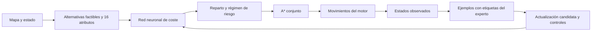
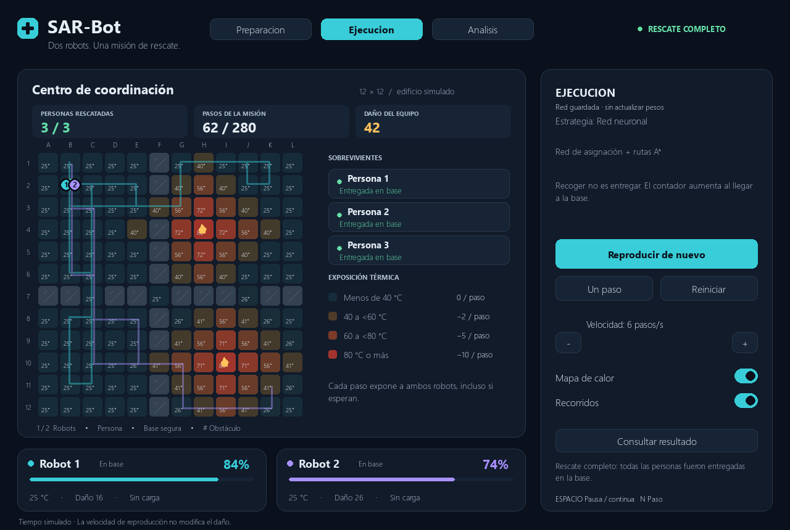

# SAR-Bot: asignación neuronal y planificación de rescates

Informe técnico del proyecto vigente en `main`, actualizado el 26 de noviembre de 2026. Equipo de cuatro integrantes, asignatura Sistemas Inteligentes. El código, los datos, las redes, los protocolos y las trazas acompañan este informe.

## 1. Problema y resultado

Dos robots deben recoger a tres personas inmóviles y entregarlas en una base segura dentro de un edificio 12 × 12. Cada robot transporta una persona por viaje. Paredes, conflictos de movimiento y exposición al calor condicionan el rescate. El objetivo combina completar la misión, reducir pasos y evitar daño.

El controlador actual es un sistema híbrido: **una red neuronal compartida decide el reparto de personas y el régimen de exposición; A* conjunto calcula movimientos**. El motor aplica todas las reglas. La red se entrenó mediante regresión supervisada del coste estimado de alternativas de rescate. La aplicación la utiliza como agente principal y permite continuar su aprendizaje entre misiones.

En veinte casos de validación completó veinte rescates. En **cuarenta ubicaciones reservadas nuevas completó 40/40 misiones y entregó 120/120 personas**, con 41,20 pasos y 13,825 puntos de daño en promedio. El caso inicial de la interfaz completa tres entregas en 62 pasos, con daño 42.

## 2. Por qué se replanteó el aprendizaje

El controlador anterior usaba DQN para elegir directamente una de 25 acciones conjuntas de movimiento, a partir de 390 observaciones. Obtuvo 3/20 misiones completas en validación y 0/40 en su prueba original. Las trazas mostraron vueltas repetidas y entregas parciales; la aplicación funcionando no demostraba que el agente aprendido resolviera el rescate.

Se cambió la tarea que aprende la red: decidir objetivos y riesgo, con navegación programada. **Es otro controlador y otro método de entrenamiento**, no una mejora atribuible solo a entrenar más el DQN. Se conservaron las evidencias anteriores en `artifacts/final/` y `results/final/` y se preparó una prueba nueva para el controlador actual.

Las dos arquitecturas se probaron en los mismos veinte casos de validación. Sus pruebas reservadas contienen posiciones distintas y no se mezclan como si fueran el mismo experimento. La interfaz vigente usa `artifacts/rescue_network/model.zip`. La etiqueta anterior se conserva por trazabilidad; se continúa trabajando en la misma rama sin nuevas etiquetas de versión.

## 3. Entorno y reglas

El escenario fija una cuadrícula, paredes, base, tres personas, focos térmicos y límite de pasos. El estado contiene posición, integridad y carga de ambos robots, personas entregadas y pasos transcurridos. Todo el mapa es conocido. La temperatura es estática y se calcula como el máximo de contribuciones de focos con distancia Manhattan; las paredes no atenúan el calor.

Cada paso ejecuta simultáneamente arriba, abajo, izquierda, derecha o esperar por cada robot. El motor impide paredes, coincidencias fuera de la base e intercambios de frente, y permite seguir a un robot que desaloja una celda. La base admite ambos. Recoger y entregar ocurre automáticamente al ocupar la celda adecuada.

| Temperatura | Daño por robot y paso |
|---|---:|
| Menos de 40 °C | 0 |
| Desde 40 y menos de 60 °C | 2 |
| Desde 60 y menos de 80 °C | 5 |
| Desde 80 °C | 10 |

Cada robot empieza con integridad 100, sin reparación. Ambos acumulan daño en todos los pasos, incluso al esperar. La destrucción se resuelve antes de recoger o entregar. La velocidad visual no altera la exposición. La misión tiene éxito al entregar las tres personas manteniendo ambos robots operativos; falla por destrucción de cualquiera y se trunca al alcanzar el máximo de pasos.

La simulación no representa física real de incendios. No incluye batería, fuego dinámico, visión artificial, varios pisos ni exploración sin mapa.

## 4. Qué decide la red

Cuando queda un robot libre, se enumeran repartos factibles entre las personas pendientes. Se excluyen personas entregadas, transportadas o ya asignadas a otro robot. Se conserva cada asignación hasta la recogida. Un robot con carga se dirige a la base. Estas restricciones son programadas.

Cada reparto se considera bajo dos pesos térmicos: **0,05**, que prioriza avanzar rápido, y **2**, que penaliza más la exposición. Con tres personas pendientes y ambos robots libres existen como máximo doce alternativas: seis repartos por dos regímenes. La red predice un coste por alternativa y se elige la de menor predicción. No se sustituye silenciosamente su elección por la asignación de una referencia.

La navegación A* minimiza `pasos + peso × exposición` hacia los objetivos elegidos, considerando los movimientos conjuntos y las colisiones. Los movimientos efectivos se aplican exclusivamente mediante el motor. La red no predice píxeles ni movimientos individuales y el planificador no aprende pesos.



### Arquitectura y atributos

La red es una MLP **16 → 64 → 32 → 1**, con ReLU en las dos capas ocultas y 3201 parámetros. Produce un escalar por alternativa. Se usa la misma red para coordinar los dos agentes físicos; no son dos redes independientes ni aprendizaje multiagente descentralizado.

Por robot se aportan seis atributos: distancia al objetivo, daño previsto hasta él, distancia posterior a la base, daño de ese retorno, déficit de integridad y presencia de carga. Se añaden cuatro atributos globales: distancia y daño del viaje restante no asignado, fracción de personas pendientes y diferencia de carga de recorrido entre robots. Las distancias se normalizan por cuatro veces el lado máximo; daño e integridad, por 100.

Las características de ruta proceden de Dijkstra sobre el mapa completo con el régimen térmico candidato. Constituyen conocimiento programado suministrado a la red, no percepción descubierta por entrenamiento.

### Etiquetas y entrenamiento

Un estimador programado combina máximo de recorridos individuales, una cuarta parte de su suma, dos veces el daño previsto, viajes restantes y una penalización de 1000 por destrucción prevista. El valor se divide por 100. Es una **aproximación de coste**, no el coste óptimo de toda la misión ni una recompensa DQN. No modela exactamente todas las esperas e interacciones de la posterior planificación conjunta.

Se generaron **54890 ejemplos etiquetados** sobre sesenta configuraciones de entrenamiento y 6702 sobre veinte de validación. Se muestrearon estados sintéticos en celdas accesibles, integridad entre 65 y 100, distintas personas entregadas y algunas cargas. No se presentan como trayectorias reales: permiten aprender las relaciones del estimador. Las posiciones de prueba no participaron en este proceso.

Se entrenó con Adam, tasa 0,001, lotes de 512, pérdida Smooth L1 y semilla 7 durante 250 épocas. Se seleccionó la **época 110**, primera con el menor arrepentimiento de elección en validación. Arrepentimiento significa la diferencia entre el coste experto de la opción elegida por la red y el mínimo experto disponible. Los metadatos, fuentes y registros están en `artifacts/rescue_network/`.

Se ensayó primero asignación con un único régimen térmico y después asignación con elección de riesgo. Ambos se examinaron exclusivamente en desarrollo y validación antes de congelar el modelo elegido. Sus resultados se conservan en `results/assignment/`.

## 5. Protocolo y evaluación

Se crearon cuarenta posiciones reservadas nuevas: veinte por edificio, con seis casos fáciles, siete intermedios y siete exigentes por edificio. Se verificó que ninguna identidad física coincidiera con los 120 casos del manifiesto anterior. Los casos se admitieron mediante certificación positiva por referencias, condición que favorece sus resultados.

Antes de abrir la nueva prueba se conservaron el modelo, metadatos y protocolo en el commit **c2bf859**. El SHA-256 del modelo es `499c8c17f383cdc9f72b29fa4da7fe7d2a4a68e2fd5fa69ee23d7d470ab599ae`. `configs/assignment_protocol.json` fija el manifiesto, el modelo y seis semillas de redes sin entrenar: 0, 1, 2, 3, 4 y 7.

Se ejecutaron **360 episodios**: cuarenta de la red entrenada, 240 de las seis redes sin entrenar y ochenta de referencias térmica y corta. Todas las redes comparten arquitectura y planificador. La inicialización de semilla 7 es exactamente la inicialización de partida del modelo entrenado. Los pesos congelados no se ajustaron después de observar la prueba.

Todas las acciones se reprodujeron en un motor nuevo y sus métricas se contrastaron con el CSV. Al escribir el marcador final hubo un error de formato de ruta relativa, después de conservar todos los episodios y diagnósticos. Se verificaron los 360 registros antes de completar el marcador, sin repetir ninguna política; esa recuperación está registrada.

### Resultados principales

| Controlador | Éxitos | Personas entregadas | Pasos medios en éxitos | Daño medio en éxitos |
|---|---:|---:|---:|---:|
| Red entrenada + A* | 40/40 | 120/120 | 41,20 | 13,825 |
| Misma red antes de entrenar + A* | 40/40 | 120/120 | 43,625 | 15,625 |
| Referencia térmica | 40/40 | 120/120 | 44,275 | 13,80 |
| Referencia corta | 33/40 | 109/120 | 37,273 | 44,182 |

Los tres primeros renglones comparten los mismos cuarenta éxitos y permiten comparar sus costes directamente. Frente a su inicialización sin entrenar, el aprendizaje reduce **2,425 pasos y 1,8 puntos de daño por misión** en promedio. Frente a la térmica reduce 3,075 pasos, con 0,025 puntos más de daño. La media de la ruta corta corresponde a un subconjunto diferente; su comparación emparejada se presenta en las tablas generadas.

Las otras inicializaciones sin entrenar completaron entre 37 y 40 casos. Esto muestra que el planificador aporta gran parte de la capacidad básica de rescate. No se atribuye toda la tasa de éxito a entrenar la red ni se afirma superioridad universal sobre planificación clásica.

### Medida directa de aprendizaje

Se plantearon las mismas **2400 preguntas sintéticas reservadas** a todas las redes. La entrenada eligió una alternativa de coste experto mínimo en **99,625 %** de las preguntas. Su inicialización sin entrenar obtuvo **37,375 %**. Las otras cinco inicializaciones obtuvieron entre 28,708 % y 38,375 %.

Esta medida demuestra aproximación del criterio del experto en posiciones nuevas. No equivale a rescate óptimo, inteligencia general ni una tasa de éxito del 99,625 %. Las preguntas comparten mapas y posiciones y no se consideran muestras independientes.

Las [tablas completas](../results/assignment/report.md) incluyen los seis controles sin entrenar, pares comunes, hashes y todas las fuentes. Se regeneran con `scripts/report_assignment.py`.

## 6. Aprendizaje persistente entre misiones

En la aplicación, **Solo ejecutar** usa la red base congelada. **Aprender** recupera una sesión separada por perfil y hash de esa base. Cada misión nueva terminada se reproduce para validar sus acciones. Cada tres pasos observados se generan alternativas de asignación factibles y etiquetas del mismo experto de costes.

Se conserva una memoria de hasta 4096 ejemplos. Se mezcla con los ejemplos base de ensayo para reducir olvido, y se realizan hasta 64 actualizaciones con Adam a tasa 0,00005. Es aprendizaje supervisado adicional con estados observados, no refuerzo por recompensas ni exploración aleatoria de movimientos.

Se comprueba la política candidata en seis controles de entrenamiento y en la misión recién terminada si no está incluida. Se comparan misiones completas, personas entregadas y el negativo de `pasos + 2 × daño`, en ese orden. Si la tupla empeora o la comprobación falla, se recuperan red y optimizador anteriores. Se guardan las experiencias aunque los pesos candidatos se rechacen. Esto no garantiza mejora fuera de los controles.

Modelo, optimizador, memoria, estados aleatorios y contadores se publican en generaciones verificadas mediante hashes, con copia anterior y bloqueo de escritor. Reproducir una misión, importar historial o comparar no entrena ni duplica una actualización. Las identidades de prueba están protegidas.

Comprobación real: dos procesos independientes sobre dos casos de entrenamiento completaron tres rescates en 12 y 16 pasos. Se acumularon **2 misiones, 28 pasos observados, 40 ejemplos de asignación y 128 actualizaciones aceptadas**. Los parámetros cambiaron; la puntuación de los seis controles permaneció igual. No se afirma una mejora adicional de rendimiento por esas dos misiones. La red base conservó su hash.

Fuentes: `results/assignment/online/persistence.json` y checkpoint de sesión archivado. Las sesiones personales de `outputs/` no se distribuyen como estado inicial.

## 7. Interfaz y presentación

`run.bat` abre el caso inicial con el agente neuronal. La preparación muestra mapas compatibles, colocación de personas y dos opciones de ejecución y aprendizaje. Los modelos históricos y estrategias programadas no compiten como opciones principales. Las referencias se consultan en comparación, que parte de las mismas condiciones y permite ver cada recorrido.

La ejecución muestra rescates, pasos, temperatura, integridad, carga, recorridos y objetivo de cada robot. La velocidad es visual. Se puede pausar, avanzar por pasos y conservar historial y exportaciones. Una preparación o actualización no bloquea el hilo de dibujo.



El guion vigente está en [DEMO.md](DEMO.md). Se debe explicar qué aprende la red, qué está programado y qué demuestran las comparaciones; no presentar A* como navegación aprendida.

## Corrección posterior de espera en base

Tras el experimento congelado se corrigió un empate del planificador que permitía mover sin tarea a un robot por celdas frías. El agente actual espera cuando está en la base, sin carga y sin otro objetivo. En los veinte casos de validación se conservaron rescates, pasos y daño y se eliminaron 88 salidas innecesarias. La red no se reentrenó. Los resultados reservados anteriores conservan su configuración y trazas originales. [Caso comunicado y evidencia](../results/navigation_wait/README.md).

## 8. Límites y reproducibilidad

- Una semilla entrenada; las seis redes sin entrenar no sustituyen réplicas de entrenamiento.
- Dos edificios conocidos, calor estático y posiciones nuevas. No se evaluaron edificios desconocidos ni incertidumbre de sensores.
- Características, restricciones y etiquetas programadas. La red aproxima preferencias expertas; no descubre una política de navegación desde cero.
- Selección repetida por validación y certificación favorable a referencias. No se ajustó el modelo después de abrir las cuarenta posiciones nuevas.
- Los ejemplos sintéticos y misiones están relacionados por geometría. Se informan conteos y pares sin intervalos que supongan independencia.
- El control de regresiones de sesión solo cubre casos de entrenamiento. Una actualización aceptada puede empeorar otros casos.

Se aprobaron **330 pruebas automatizadas**, además de verificar los 360 episodios y comprobar dos procesos reales de aprendizaje. Las dependencias están fijadas en `uv.lock`; la red se ejecuta en CPU. Las cifras anteriores pertenecen al modelo congelado, no a una sesión posteriormente adaptada.

```powershell
uv sync --locked --extra ui --extra rl --python 3.12
.\run.bat
uv run --locked --extra ui --extra rl python -m unittest discover -s tests
uv run --locked python scripts/report_assignment.py --check
```

La última comprobación regenera tablas y reproduce acciones guardadas; no vuelve a entrenar ni a abrir la prueba. La propuesta original y las decisiones del equipo no constituyen una rúbrica confirmada del profesor. La entrega documenta el funcionamiento técnico y el alcance observado del agente.
