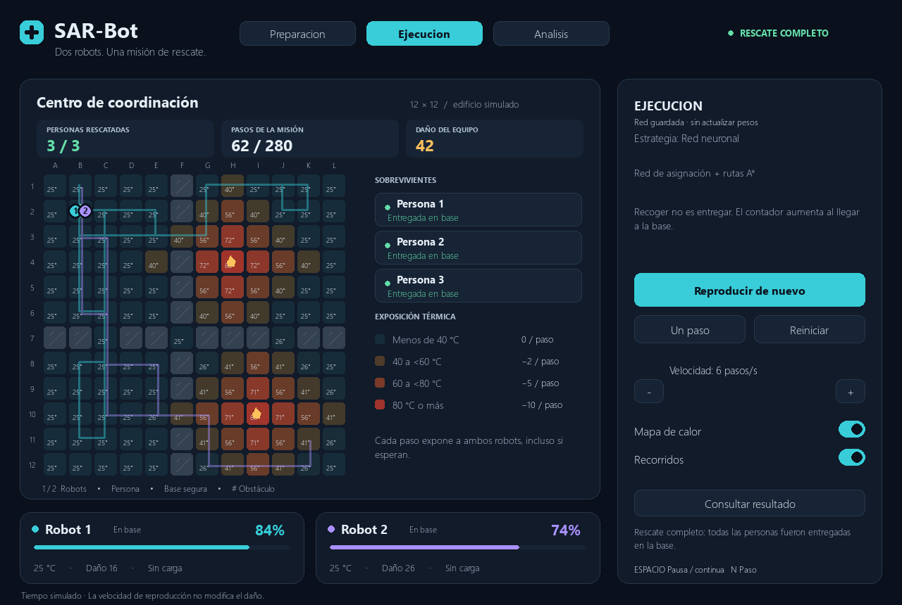

# Interfaz de SAR-Bot

## Agente principal

Cerrar la ventana anterior y abrir `run.bat` para cargar el código y modelo actuales. La pantalla principal utiliza **Red neuronal de rescate**. Las referencias programadas se consultan en comparación. El modelo es `artifacts/rescue_network/model.zip`.

La red aprende a asignar personas a los robots y elegir entre rapidez y menor exposición. A* calcula los movimientos. Cada robot mantiene su objetivo hasta recoger y vuelve a la base para entregar. La red actual es supervisada; el DQN de movimientos es un antecedente conservado, no el inicio recomendado.

## Preparación

| Control | Función |
|---|---|
| Mapa del edificio | Elegir uno de los mapas compatibles con el agente actual. |
| Colocar personas | Editar las tres ubicaciones; validar antes de preparar. |
| Solo ejecutar | Usar la red base sin actualizarla. |
| Aprender | Recuperar la sesión y aprender de misiones nuevas terminadas. |
| Guardar mapa / Mis mapas | Conservar y cargar configuraciones personales. |
| Preparar nueva misión | Calcular una misión nueva con la configuración y modo actuales. |
| Ver misión y controles | Abrir reproducción, pausa, pasos y velocidad. |
| Comparar las 4 estrategias | Intentar el mismo rescate con la red y tres referencias. |

Hay una única red de rescate recomendada, por lo que no se muestra un selector innecesario. Los modelos antiguos y los mapas de otros tamaños no aparecen en el flujo principal. Las herramientas de investigación y las referencias siguen disponibles por CLI para reproducir antecedentes.

## Ejecución

La pantalla muestra entregas, pasos, daño, temperatura y estado de cada persona. Cada tarjeta de robot indica carga, integridad y objetivo: hacia una persona o volviendo a la base. La velocidad modifica la reproducción; no cambia el daño por paso. Cuando un robot queda libre en la base aparece **Esperando en base** y permanece allí; la base compartida permite que el otro entregue.

Recoger no equivale a entregar. Un robot transporta una persona y el contador aumenta al llegar a la base. La misión termina al entregar a las tres personas manteniendo ambos robots vivos, por destrucción de un robot o al agotar los pasos.

Pausar, avanzar un paso o volver a reproducir una misión no crea nuevas experiencias de entrenamiento. Preparar una misión nueva genera una identidad nueva.

## Comparación

Se ejecutan desde las mismas condiciones iniciales:

- **Red neuronal:** reparto y riesgo aprendidos, navegación A*.
- **Ruta corta:** planificación que ignora el calor.
- **Ruta segura:** planificación con un peso térmico fijo.
- **Movimientos al azar:** referencia básica sin planificación.

Las filas muestran entregas, finalización, pasos y daño. **Ver recorrido** reproduce las acciones conservadas de esa fila sin entrenar. Un fracaso con poco daño no es un mejor rescate. Exportar conserva los resultados; historial permite consultar y reproducir misiones.

La comparación usa el modelo base congelado para mantener condiciones reproducibles, incluso si existe una sesión adaptada.

## Aprender y guardar

Al terminar una misión nueva en Aprender se validan sus acciones contra el motor. Se generan ejemplos de asignación a partir de estados observados, con etiquetas del mismo experto de costes. Se ensaya una actualización y se compara con la red previa sobre seis controles de entrenamiento y, si es distinta, la misión actual.

Si la puntuación agregada empeora, se recuperan pesos y optimizador anteriores. Las experiencias quedan guardadas. La protección no garantiza mejora en posiciones nuevas. Mientras se comprueba y guarda, se bloquean cambios incompatibles de configuración y aparece un aviso explicativo.

El guardado conserva red, optimizador, ejemplos, generadores aleatorios y contadores en `outputs/learning_sessions/`, por perfil y hash de la base. Al reiniciar, seleccionar **Aprender** recupera la sesión. **Solo ejecutar** vuelve a la base reproducible. Los casos reservados se rechazan para aprendizaje.

Comprobación real del agente actual: dos procesos, dos misiones completadas, 28 pasos observados, 40 ejemplos y 128 actualizaciones aceptadas. Los parámetros cambiaron; el resultado de controles se mantuvo. [Evidencia](../results/assignment/online/persistence.json).

## Antecedentes

Las capturas y auditorías anteriores corresponden a interfaces de desarrollo y al DQN de movimientos. Sus nombres y opciones quedan reemplazados por esta guía. El código y los resultados históricos se conservan para trazabilidad; los datos de prueba originales no se reutilizaron para ajustar el agente nuevo.
