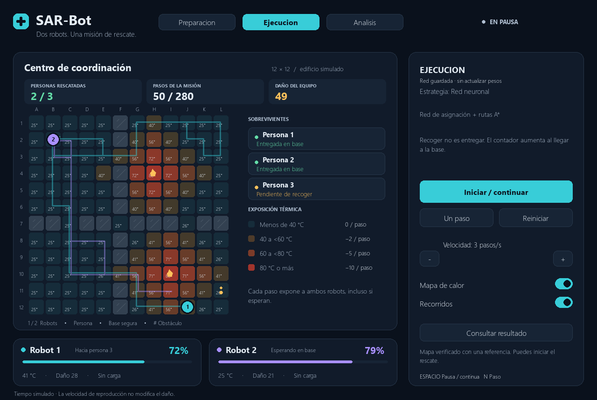

# Espera del robot sin tarea en la base

Corrección de navegación posterior al experimento congelado en `c2bf859`. No se reentrenó ni modificó la red. Las referencias históricas conservan su comportamiento original; el agente neuronal activa la espera por defecto.

## Causa

A* minimizaba pasos globales y exposición. Mover al robot libre por celdas frías y dejarlo esperando tenían el mismo coste. Su plan podía contener salidas y vueltas a la base sin ninguna tarea.

## Corrección

Cuando un robot está en la base, sin carga y con la base como objetivo, el planificador solo considera esperar para ese robot. Al cambiar esta condición se invalida el plan almacenado: un recorrido calculado antes de entregar no puede volver a sacarlo de la base. La base es térmicamente segura y admite a ambos robots, por lo que esperar allí permite que el compañero entregue su carga.

La tarjeta de ejecución indica «Esperando en base» o «Volviendo a base» cuando corresponde. Se conserva la reproducción exacta de las trazas históricas; preparar otra misión calcula un recorrido nuevo.

## Reproducción del caso comunicado

Edificio Centro de coordinación, personas en L3, I11 y L11 (coordenadas desde cero: `(11,2)`, `(8,10)`, `(11,10)`). La comparación usa los mismos pesos de red:

| Medida | Antes | Corregido |
|---|---:|---:|
| Personas entregadas | 3/3 | 3/3 |
| Pasos globales | 74 | 74 |
| Daño total | 61 | 61 |
| Desplazamientos individuales | 144 | 104 |
| Salidas de la base sin carga ni tarea | 20 | 0 |

`regression.json` conserva el escenario completo y las dos secuencias de acciones. El robot que queda libre puede cambiar de número según los pesos de sesión; la regla se aplica a ambos por igual.

## Comprobaciones

- Los veinte casos de validación siguen completándose. Se conservaron exactamente pasos y daño en los veinte.
- Las salidas innecesarias acumuladas bajaron de 88 a cero: `validation.json`.
- Se probaron ambos órdenes de robots en un pasillo con base compartida: el que espera no bloquea la entrega del compañero.
- Las comparaciones reservadas publicadas pertenecen al controlador congelado anterior a esta corrección. Su protocolo conserva `idle_at_base=False` por compatibilidad cuando no declara la opción; los datos y sus hashes no se reescribieron.

Los pesos, las etiquetas de entrenamiento y las condiciones del motor permanecen intactos. Esta es una corrección del planificador, no un resultado de entrenamiento adicional.

**Suite completa: 330 pruebas, OK** (319,888 s). Registro: `verification.json`.

